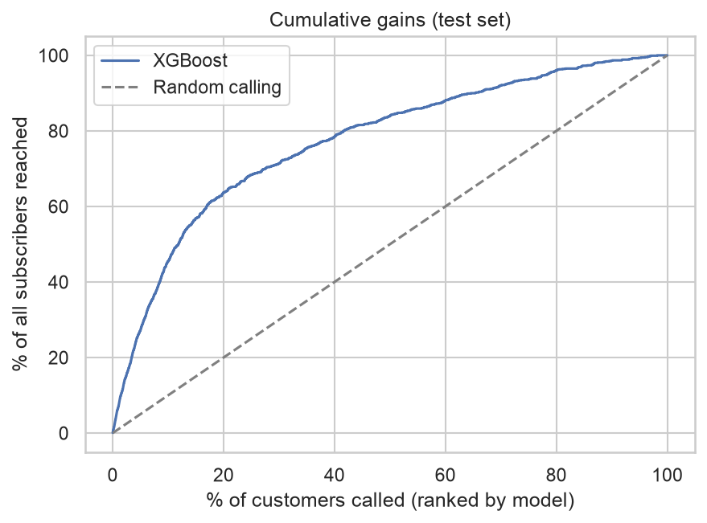
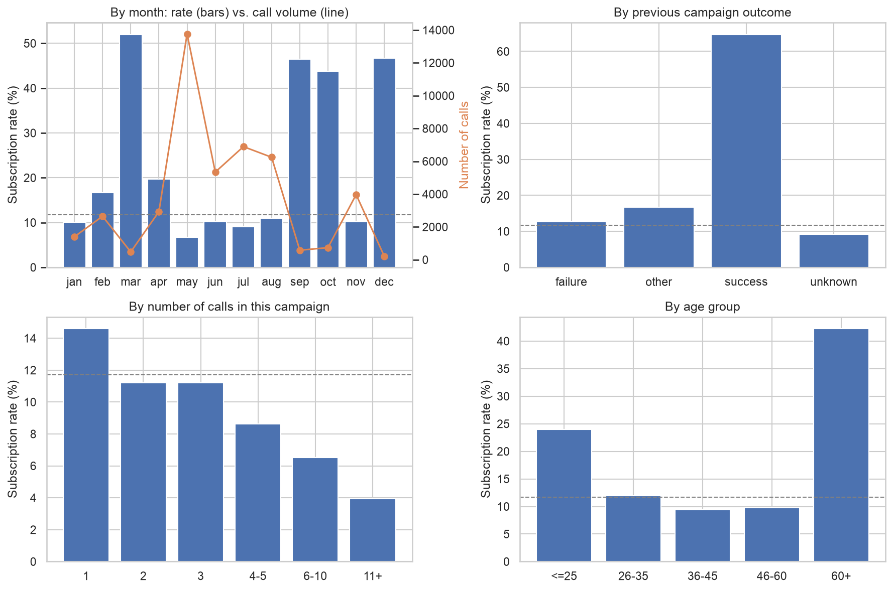
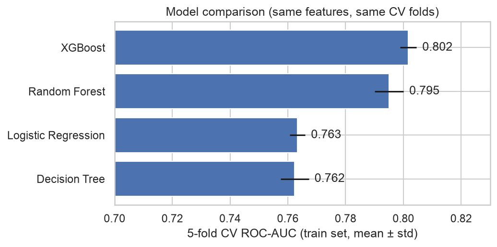
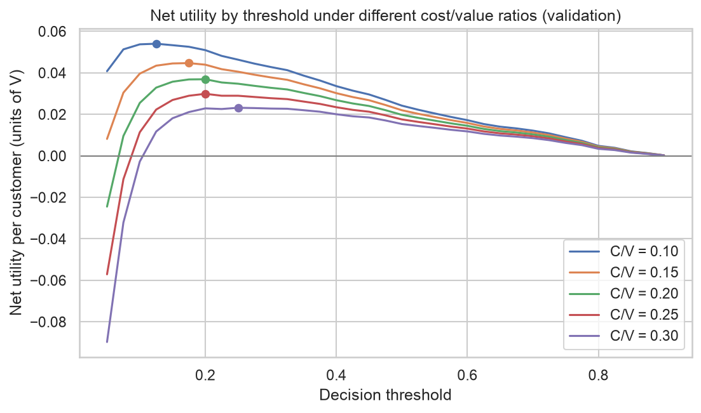
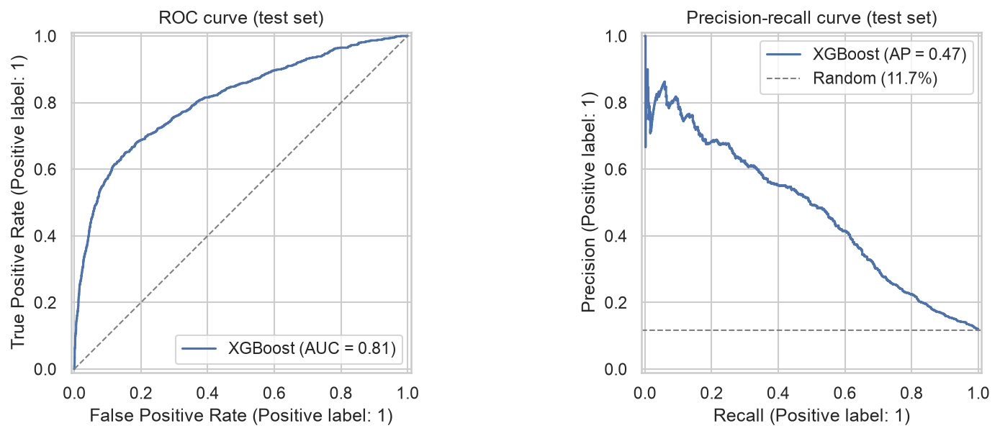
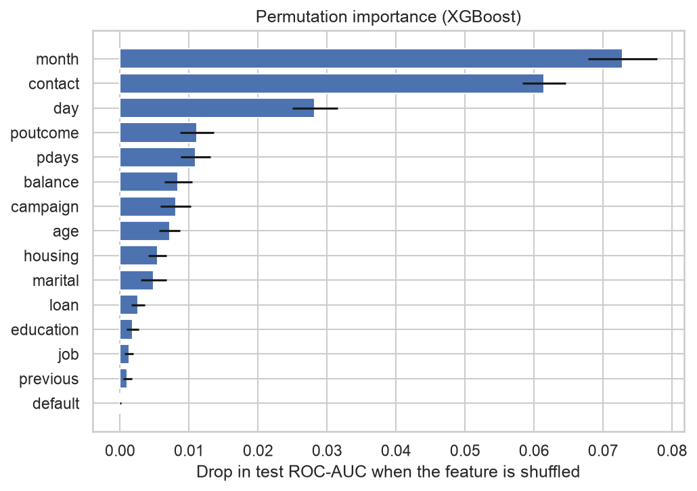

# Bank Marketing: Who Should the Call Center Call?

Predicting which bank customers will subscribe to a term deposit, then turning the model into a calling strategy under different cost assumptions.

**Python · pandas · scikit-learn · XGBoost · imbalanced-learn · matplotlib · seaborn**



## Contents

1. [Business problem](#1-business-problem)
2. [Key results](#2-key-results)
3. [Data](#3-data)
4. [Exploratory analysis](#4-exploratory-analysis)
5. [Methodology, step by step](#5-methodology-step-by-step)
6. [Results in detail](#6-results-in-detail)
7. [Recommendations](#7-recommendations)
8. [Limitations](#8-limitations)
9. [How to run](#9-how-to-run)
10. [Repository structure](#10-repository-structure)

---

## 1. Business problem

A Portuguese retail bank sells term deposits through outbound phone campaigns. Each call costs agent time, and only **11.7%** of 45,211 calls end in a subscription.

If the bank can rank customers by how likely they are to subscribe *before* calling, it can either call fewer people for the same number of subscriptions, or reach more subscribers with the same call-center capacity.

This project answers three questions:

1. **Can we predict subscription from information available before the call?**
2. **How should the bank decide whom to call**, given that the cost of a call and the value of a subscription differ?
3. **What drives subscription?**

## 2. Key results

All results are on a held-out test set of 9,043 customers that was used only once.

| Metric | Result |
| --- | --- |
| Best model | XGBoost, selected by 5-fold cross-validation |
| Test ROC-AUC | **0.809** |
| Test PR-AUC | **0.472** (a random ranking gets 0.117) |
| Call the top 10% of the ranking | reach **45.5%** of all subscribers (4.5x random) |
| Call the top 20% of the ranking | reach **63.7%** of all subscribers (3.2x random) |
| Strongest drivers | month of contact, contact channel, day of month, previous campaign outcome |

## 3. Data

[UCI Bank Marketing dataset](https://doi.org/10.24432/C5K306) (`bank-full.csv`): 45,211 phone calls from May 2008 to November 2010, 16 input columns, target `y` (subscribed yes/no).

| Column | Type | Meaning |
| --- | --- | --- |
| `age` | numeric | Client age |
| `job`, `marital`, `education` | categorical | Demographics |
| `default`, `housing`, `loan` | categorical | Credit in default? Housing loan? Personal loan? |
| `balance` | numeric | Average yearly account balance (euros) |
| `contact` | categorical | Contact channel: cellular / telephone / unknown |
| `day`, `month` | numeric / categorical | Day and month of the last contact |
| `duration` | numeric | Length of the last call (**dropped**, see step 1 below) |
| `campaign` | numeric | Number of contacts in this campaign |
| `pdays` | numeric | Days since last contact in a previous campaign (-1 = never) |
| `previous` | numeric | Number of contacts before this campaign |
| `poutcome` | categorical | Outcome of the previous campaign |

Data quality notes:

- No NaNs, but missing values appear as the string `"unknown"` (82% of `poutcome`, 29% of `contact`, 4% of `education`, 0.6% of `job`).
- `"unknown"` is informative: clients with unknown contact channel subscribe at **4%** vs **15%** for cellular. It is kept as its own category instead of being imputed.
- `pdays = -1` lines up exactly with `previous = 0`, so it is a code for "never contacted", not an error.

## 4. Exploratory analysis



| Finding | Detail |
| --- | --- |
| **Month reflects campaign intensity** | May had about 13,800 calls and a 7% subscription rate; March, September, October and December had only a few hundred calls each and converted at 44% to 52%. |
| **Past success predicts future success** | Clients who subscribed in a previous campaign subscribe again about 65% of the time, vs 9% to 17% for everyone else. |
| **Repeated calls have diminishing returns** | The rate falls from about 15% on the first call to about 4% after more than ten calls. |
| **Age is U-shaped** | Clients aged 25 and under (about 24%) and over 60 (about 42%) subscribe far more often than working-age clients (9% to 12%). |

## 5. Methodology, step by step

The full code with explanations is in [`notebooks/bank_marketing_prediction.ipynb`](notebooks/bank_marketing_prediction.ipynb). The key steps:

### Step 1: Remove data leakage

`duration` (length of the current call) is the most predictive column, but it is only known **after** the call ends. A model that uses it cannot decide whom to call, so it is dropped. That leaves 15 features (6 numerical, 9 categorical).

```python
y = df["y"].eq("yes").astype(int)
X = df.drop(columns=["y", "duration"])
```

### Step 2: Split once, keep the test set untouched

80/20 stratified split. Every decision (model, hyperparameters, threshold) is made on the training set with cross-validation; the test set is used once at the end.

```python
X_train, X_test, y_train, y_test = train_test_split(
    X, y, test_size=0.2, stratify=y, random_state=42
)
CV = StratifiedKFold(n_splits=5, shuffle=True, random_state=42)
```

### Step 3: Preprocessing inside a pipeline

Numerical columns are median-imputed and standardized; categorical columns are one-hot encoded (15 columns become 50). Because it sits inside a scikit-learn `Pipeline`, preprocessing is re-fitted within every CV fold and never sees validation data.

```python
def make_preprocessor(num_cols, cat_cols):
    numeric = Pipeline([("imputer", SimpleImputer(strategy="median")),
                        ("scaler", StandardScaler())])
    categorical = Pipeline([("imputer", SimpleImputer(strategy="most_frequent")),
                            ("onehot", OneHotEncoder(handle_unknown="ignore"))])
    return ColumnTransformer([("num", numeric, num_cols),
                              ("cat", categorical, cat_cols)])
```

### Step 4: Compare four models on equal terms

Logistic regression, decision tree, random forest and XGBoost: same features, same folds, tuned with `GridSearchCV` on ROC-AUC. PR-AUC is tracked as well, because with 12% positives it better reflects how precise the top of the ranking is.

```python
pipe = Pipeline([("prep", make_preprocessor(NUM_COLS, CAT_COLS)), ("model", est)])
gs = GridSearchCV(pipe, grid,
                  scoring={"roc_auc": "roc_auc", "pr_auc": "average_precision"},
                  refit="roc_auc", cv=CV, n_jobs=-1)
gs.fit(X_train, y_train)
```

| Model | Settings searched | Best settings |
| --- | --- | --- |
| Logistic Regression | `C` (6 values) | `C=0.05` |
| Decision Tree | depth x min leaf size (12 combinations) | `max_depth=12`, `min_samples_leaf=100` |
| Random Forest | depth x min leaf size (9 combinations), 300 trees | `max_depth=20`, `min_samples_leaf=10` |
| XGBoost | trees x learning rate x depth x subsample x column sample (108 combinations) | `n_estimators=300`, `learning_rate=0.03`, `max_depth=6`, `subsample=0.8`, `colsample_bytree=0.8` |



### Step 5: Handle class imbalance the right way

Oversampling the minority class is a common reflex, but it must happen **inside** each CV fold. Resampling the whole training set first puts synthetic near-copies of the same customers into both training and validation folds. The notebook demonstrates this on the data:

| Approach | CV ROC-AUC | Test ROC-AUC |
| --- | --- | --- |
| SMOTE on the whole training set, then CV (**wrong**) | 0.964 | 0.790 |
| SMOTE inside each CV fold (correct) | 0.780 | |
| No resampling | **0.802** | **0.809** |

```python
from imblearn.pipeline import Pipeline as ImbPipeline

pipe = ImbPipeline([("prep", make_preprocessor(NUM_COLS, CAT_COLS)),
                    ("smote", SMOTE(random_state=42)),   # applied to training folds only
                    ("model", xgb())])
cross_val_score(pipe, X_train, y_train, cv=CV, scoring="roc_auc")
```

Measured correctly, none of the four options (no resampling, `scale_pos_weight`, random oversampling, SMOTE) improved ranking quality, so the plain model is kept and imbalance is handled through the decision threshold (step 7).

| Variant (all inside CV) | CV ROC-AUC | CV PR-AUC |
| --- | --- | --- |
| No resampling | 0.802 | 0.455 |
| `scale_pos_weight` | 0.798 | 0.448 |
| Random oversampling | 0.797 | 0.447 |
| SMOTE | 0.780 | 0.424 |

### Step 6: Check feature selection

Dropping the three weakest features (`default`, `job`, `education`) changed CV ROC-AUC by +0.0009, far less than the fold-to-fold standard deviation (about 0.003). The final model keeps all 15 features so every model is compared on the same inputs.

### Step 7: Choose the call threshold from economics

A score alone does not say whom to call. With **C** = cost of a call and **V** = value of a subscription, calling pays off when precision > C/V. Net value per customer:

```
utility(t) = outreach_rate(t) × (precision(t) − C/V)
```

The threshold is chosen on a validation split carved out of the training set, for C/V ratios from 0.10 to 0.30, and then checked once on the test set.

```python
for r in [0.10, 0.15, 0.20, 0.25, 0.30]:
    util = val_thr["outreach_rate"] * (val_thr["precision"] - r)
    best_threshold = val_thr.loc[util.idxmax(), "threshold"]
```



### Step 8: Explain the model

Permutation importance on the test set, computed on the 15 original columns (so a categorical variable is scored as a whole, not as separate dummies): shuffle one column, measure the drop in ROC-AUC, repeat 10 times.

## 6. Results in detail

### Model performance

| Model | CV ROC-AUC | CV PR-AUC | Test ROC-AUC | Test PR-AUC |
| --- | --- | --- | --- | --- |
| **XGBoost** | **0.802** | **0.455** | **0.809** | **0.472** |
| Random Forest | 0.795 | 0.444 | 0.806 | 0.455 |
| Logistic Regression | 0.763 | 0.403 | 0.773 | 0.411 |
| Decision Tree | 0.762 | 0.393 | 0.772 | 0.415 |

Test scores match the CV estimates, so the model generalizes and the CV process was reliable. Tree ensembles beat the linear model by about 0.04 ROC-AUC, pointing to non-linear effects and interactions.



### Calling strategy by cost scenario (test set)

| Cost/value ratio (C/V) | Threshold | Precision | Recall | % of customers called |
| --- | --- | --- | --- | --- |
| 0.10 | 0.125 | 36% | 65% | 21% |
| 0.15 | 0.175 | 45% | 56% | 15% |
| 0.20 | 0.200 | 48% | 54% | 13% |
| 0.25 | 0.200 | 48% | 54% | 13% |
| 0.30 | 0.250 | 51% | 49% | 11% |

Example: if a call costs 20% of what a subscription is worth, calling only the 13% of customers scoring above 0.20 reaches 54% of all subscribers, and 48% of those calls convert (vs 11.7% when calling at random). Test values closely match the validation values used to pick the thresholds.

### Cumulative gains (test set)

| % of customers called | % of subscribers reached | Lift vs random |
| --- | --- | --- |
| 10% | 45.5% | 4.5x |
| 20% | 63.7% | 3.2x |
| 30% | 71.4% | 2.4x |
| 40% | 78.4% | 2.0x |
| 50% | 83.9% | 1.7x |

### What drives the prediction



`month` and `contact` channel matter most, followed by `day`, previous campaign outcome (`poutcome`) and days since last contact (`pdays`). Demographics such as job, education and marital status add little once these are known.

## 7. Recommendations

1. **Rank before calling.** Score every customer and work the list from the top; the top fifth of the list holds nearly two-thirds of the subscribers.
2. **Set the cut-off from economics, not 0.5.** Estimate the real cost per call and value per subscription, then read the threshold from the utility analysis.
3. **Prioritize previous subscribers** and cap repeat calls to the same person, since conversion falls steadily after the first few contacts.

## 8. Limitations

- **Time.** The data covers 2008 to 2010, partly during the financial crisis, and month/day effects reflect that bank's campaign calendar. A random split lets the model learn those calendar patterns; a deployment would need a time-based split and periodic retraining.
- **Costs are assumed.** The C/V ratios are scenarios, not the bank's real figures, so the strategy table supports a decision rather than estimates profit.
- **Correlation, not causation.** The model ranks customers by likelihood; it does not show that calling in a given month causes a subscription.
- **Single dataset.** Results have not been validated on other banks or later campaigns.

## 9. How to run

```bash
git clone https://github.com/hgao1023/bank-marketing-prediction.git
cd bank-marketing-prediction
python -m venv .venv && source .venv/bin/activate
pip install -r requirements.txt
cd notebooks
jupyter notebook bank_marketing_prediction.ipynb
```

The notebook runs end to end (Run All) in about 2 minutes on a laptop. All charts in `images/` are regenerated by the notebook, and a fixed random seed (42) makes every number reproducible.

## 10. Repository structure

```
bank-marketing-prediction/
├── data/
│   ├── bank-full.csv          UCI Bank Marketing data (CC BY 4.0)
│   ├── bank-names.txt         original dataset description
│   └── README.md              source and license
├── images/                    figures saved by the notebook
├── notebooks/
│   └── bank_marketing_prediction.ipynb
├── requirements.txt
└── README.md
```

## Project history

Started as a 6-person team project for *Machine Learning with Python* at Santa Clara University (Winter 2026), where I designed the workflow, wrote the initial code, and coordinated testing and revisions. This repository is the extended final version.

## Data source

Moro, S., Rita, P., & Cortez, P. (2014). *Bank Marketing* [Dataset]. UCI Machine Learning Repository. https://doi.org/10.24432/C5K306 (CC BY 4.0)
